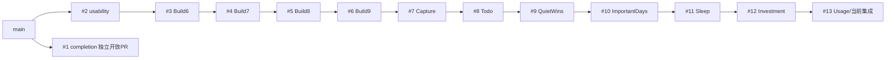

# GitHub 与本地分支只读清点（2026-10-20）

采样 `2026-10-20T06:18:29.620763+00:00`；远端29，本地8，并集30；开放PR13，全部Draft。分支/PR REST API 均 `--paginate --slurp` / per_page=100，各1页，没有遗漏后续页。已保存fetch前refs，刷新明确使用`git fetch --no-prune origin`。本轮无删除/改名/改base/merge/rebase/reset/worktree清理/清理tag。清点完成即交付，不等待删除批准。

[逐条机器数据与可复算脚本](Evidence/CI20261020/branch-inventory.json)（完整SHA、时间、upstream/ahead/behind、未推送/独有提交ID、三组祖先与最终差异、patch标记、逐文件内容比较、全部PR、worktree、tag/Docs引用）；[刷新前引用](Evidence/CI20261020/refs-before.txt)。

| 主分类 | 条数 |
|---|---:|
|叠加链基底|11|
|疑似重复待确认|3|
|必须保留|3|
|合并后候选|13|
|含未同步/独有工作|0|
|信息不足|0|

主分类互斥；“含未同步/独有工作”附加标志仍会记录在必须保留/叠加基底上，不能因主分类忽略脏状态。Todo主目录有三项未知改动；本轮未读取其内容或修改。UI独立本地分支upstream为origin/codex/usage-remediation-20261017，tip由远端候选保全，不把全部历史误写成“未推送”。

## 集成关系与未来顺序

- main: `dd09975d3a3736b24f8646fa4f197cc883ab1796`
- candidate: `50f726391f4f548647694368ad6378a901667189`
- base: `5a70f0110b151f8a45ac7c33d3f443823b1cff24`
- localCheckout: `220090d7629673e4454f7e5c81e8adc42ced732e`

箭头表示后继PR以此前分支为base；完整PR head/base SHA在JSON。#1的head已是#2及当前候选祖先，但#1仍单独指向main且开放，必须保留，未来需Owner决定其PR整合方式。#2至#13逐层开放，不应从#13向前删base。当前候选与实际base均明显领先main，祖先包含不能替代main中的验收和最终合并结果。

建议未来顺序：先解决#1与#2的Owner整合选择，按#2→#13的依赖方向验证并合入目标线；每次确认后续PR/base仍有效。全链稳定进入main后，优先复核无开放依赖、无worktree占用且内容已保全的纯规划/文档候选；再复核疑似重复的两条审查分支及本地UI分支，保留原始审查证据和恢复引用。最后才评估已不再被依赖的开发链基底。逐条固定SHA重新fetch无prune、核对未推送与未知工作、Owner另行明确批准后，才可能执行清理；本报告不授予删除权限。

两条审查分支 `plan/important-days-v1-review-fix-goal` / `plan/sleep-routine-v1-review-fix` 的git cherry均为`+`、各有1个独有历史提交；但以共同祖先取改动路径后，与候选逐文件比较，分别5/5文件字节相同。分类“疑似重复待确认”，不声称补丁等价或历史提交可丢。

## 每条分支事实与建议

| branch | 远端完整SHA / 本地完整SHA | 提交时间；upstream a/b | 三参考独有(main/候选/base)；未推送 | worktree/脏状态 | PR / 后继依赖 | tag/Docs保留引用 | 分类与前置条件 |
|---|---|---|---|---|---|---|---|
|`codex/external-capture-v1`|`c5a3c0ac859efc3ffa4e5d9f77909ec43565c871` / `无`|2026-09-26T21:31:43+08:00; 无 无|83/0/0; 0|未占用|#7 open→feature/build9-today-entry-followups / #8|testflight-external-capture-c5a3c0a,testflight-todo-v1-dc4bacc,testflight-xcode27-retry-20261020; Docs/CURRENT_STATE.md, Docs/CURRENT_TASK.md, Docs/EXTERNAL_CAPTURE_EXECUTION_PLAN.md 等9文件|叠加链基底；保留原ref；先处理后继依赖；重新核对SHA/worktree后Owner逐条批准|
|`codex/important-days-v1`|`5614246f98ae63732ccd4fd8a6b66f4a425336f2` / `5614246f98ae63732ccd4fd8a6b66f4a425336f2`|2026-10-15T19:20:53+08:00; origin/codex/important-days-v1 0/0|129/0/0; 0|/private/tmp/PersonalGrowthOS-important-days-v1 [UNKNOWN status exit=128]|#10 open→codex/quiet-wins-on-d72 / #11|testflight-xcode27-retry-20261020; Docs/CURRENT_STATE.md, Docs/CURRENT_TASK.md, Docs/IMPORTANT_DAYS_V1_ACCEPTANCE_ZH.md 等15文件|叠加链基底；保留原ref；先处理后继依赖；重新核对SHA/worktree后Owner逐条批准|
|`codex/quiet-wins-on-d72`|`20d315a62179ad29a6cbcf76c33c11638412e54e` / `2c9e4ab16bd4ed5f9c69c8a479047b198c1da4af`|2026-10-14T00:28:56+08:00; origin/codex/quiet-wins-on-d72 0/2|109/0/0; 0|/Users/himini/.codex/worktrees/quiet-wins-on-d72/PersonalGrowthOS [clean]|#9 open→codex/todo-v1-personal-actions / #10|testflight-xcode27-retry-20261020; Docs/CURRENT_STATE.md, Docs/CURRENT_TASK.md, Docs/IMPORTANT_DAYS_V1_ACCEPTANCE_ZH.md 等9文件|叠加链基底；保留原ref；先处理后继依赖；重新核对SHA/worktree后Owner逐条批准|
|`codex/sleep-routine-v1`|`ad0720ad743f495ac6f2ee3e97b16577266351db` / `ad0720ad743f495ac6f2ee3e97b16577266351db`|2026-10-15T23:24:06+08:00; origin/codex/sleep-routine-v1 0/0|148/0/0; 0|/Users/himini/.codex/worktrees/sleep-routine-v1/PersonalGrowthOS [DIRTY  M PersonalGrowthOS/Localizable.xcstrings, ?? PersonalGrowthOS.xcodeproj/xcshareddata/xcodecloud/]|#11 open→codex/important-days-v1 / #12|testflight-xcode27-retry-20261020; Docs/CURRENT_STATE.md, Docs/CURRENT_TASK.md, Docs/SLEEP_ROUTINE_V1_ACCEPTANCE_ZH.md 等12文件|叠加链基底；保留原ref；先处理后继依赖；重新核对SHA/worktree后Owner逐条批准|
|`codex/time-investment-v1`|`5a70f0110b151f8a45ac7c33d3f443823b1cff24` / `5a70f0110b151f8a45ac7c33d3f443823b1cff24`|2026-10-18T12:04:11+08:00; origin/codex/time-investment-v1 0/0|189/0/0; 0|/Users/himini/.codex/worktrees/time-investment-v1/PersonalGrowthOS [clean]|#12 open→codex/sleep-routine-v1 / #13|testflight-xcode27-retry-20261020; Docs/CI_DEVICE_BRANCH_CLEANUP_20261020_GOAL_ZH.md, Docs/CURRENT_STATE.md, Docs/CURRENT_TASK.md 等21文件|叠加链基底；保留原ref；先处理后继依赖；重新核对SHA/worktree后Owner逐条批准|
|`codex/todo-v1-personal-actions`|`d72c016dd34c8114cf44744d0e061b95bd312091` / `d72c016dd34c8114cf44744d0e061b95bd312091`|2026-10-10T21:07:20+08:00; origin/codex/todo-v1-personal-actions 0/0|101/0/0; 0|/Users/himini/Development/Projects/PersonalGrowthOS [DIRTY  M PersonalGrowthOS.xcodeproj/project.pbxproj,  M PersonalGrowthOS/Localizable.xcstrings, ?? PersonalGrowthOS.xcodeproj/xcshareddata/xcodecloud/]|#8 open→codex/external-capture-v1 / #9|testflight-xcode27-retry-20261020; Docs/CURRENT_STATE.md, Docs/CURRENT_TASK.md, Docs/IMPORTANT_DAYS_V1_DESIGN_ZH.md 等10文件|叠加链基底；保留原ref；先处理后继依赖；重新核对SHA/worktree后Owner逐条批准|
|`codex/ui-readability-localization-20261020`|`无` / `50f726391f4f548647694368ad6378a901667189`|2026-10-20T12:21:25+08:00; origin/codex/usage-remediation-20261017 0/0|244/0/55; 0|/private/tmp/PersonalGrowthOS-ui-20261020 [clean]|无 / 无|无tag包含tip; Docs/UI_READABILITY_LOCALIZATION_20261020_ZH.md|疑似重复待确认；保留原ref；main集成并验最终差异；重新核对SHA/worktree后Owner逐条批准|
|`codex/usage-remediation-20261017`|`50f726391f4f548647694368ad6378a901667189` / `220090d7629673e4454f7e5c81e8adc42ced732e`|2026-10-20T12:21:25+08:00; origin/codex/usage-remediation-20261017 4/0|244/0/55; 4|/private/tmp/PersonalGrowthOS-usage-remediation-20261017 [DIRTY  M Docs/CI_DEVICE_BRANCH_CLEANUP_20261020_BRANCH_INVENTORY_ZH.md,  M Docs/Evidence/CI20261020/branch-inventory.json,  M Docs/Evidence/CI20261020/inventory.py,  M PersonalGrowthOSUITests/AppLaunchSmokeTests.swift, ?? Docs/Evidence/CI20261020/pr-pages.json, ?? Docs/Evidence/CI20261020/remote-branch-pages.json]|#13 open→codex/time-investment-v1 / 无|无tag包含tip; Docs/CI_DEVICE_BRANCH_CLEANUP_20261020_GOAL_ZH.md, Docs/CURRENT_STATE.md, Docs/CURRENT_TASK.md 等15文件|必须保留；保留原ref；main集成并验最终差异；重新核对SHA/worktree后Owner逐条批准|
|`docs/foundation-consistency-v0.2`|`ce18ed36ce4a4866e36ab15d4b55eab4a0d410dd` / `无`|2026-07-16T00:01:29+08:00; 无 无|0/0/0; 0|未占用|无 / 无|testflight-1.0-b7,testflight-1.0-b7-r2,testflight-1.0.0-build9,testflight-build8-owner-validation-1,testflight-external-capture-c5a3c0a,testflight-todo-v1-dc4bacc,testflight-xcode27-retry-20261020; 无直接Docs名引用|合并后候选；保留原ref；main集成并验最终差异；重新核对SHA/worktree后Owner逐条批准|
|`docs/v1-autonomous-governance`|`a750d00ac914cdab16fc9418a39771c9bfb27676` / `无`|2026-07-18T21:52:26+08:00; 无 无|0/0/0; 0|未占用|无 / 无|testflight-1.0-b7,testflight-1.0-b7-r2,testflight-1.0.0-build9,testflight-build8-owner-validation-1,testflight-external-capture-c5a3c0a,testflight-todo-v1-dc4bacc,testflight-xcode27-retry-20261020; Docs/V1_AUTONOMOUS_EXECUTION_PLAN.md|合并后候选；保留原ref；main集成并验最终差异；重新核对SHA/worktree后Owner逐条批准|
|`feat/s0a-project-bootstrap`|`2bf1be85c01d8d96af035a12684bd2d98c7f183e` / `无`|2026-07-17T07:58:46+08:00; 无 无|0/0/0; 0|未占用|无 / 无|testflight-1.0-b7,testflight-1.0-b7-r2,testflight-1.0.0-build9,testflight-build8-owner-validation-1,testflight-external-capture-c5a3c0a,testflight-todo-v1-dc4bacc,testflight-xcode27-retry-20261020; Docs/S0A_TASK.md|合并后候选；保留原ref；main集成并验最终差异；重新核对SHA/worktree后Owner逐条批准|
|`feat/v1-autonomous-build`|`2e31e8a753005f8bb40bce348820529775aa2e9d` / `无`|2026-07-19T11:39:32+08:00; 无 无|0/0/0; 0|未占用|无 / 无|testflight-1.0-b7,testflight-1.0-b7-r2,testflight-1.0.0-build9,testflight-build8-owner-validation-1,testflight-external-capture-c5a3c0a,testflight-todo-v1-dc4bacc,testflight-xcode27-retry-20261020; Docs/V1_AUTONOMOUS_EXECUTION_PLAN.md, Docs/V1_AUTONOMOUS_STATUS.md, Docs/V1_CANDIDATE_REPORT.md|合并后候选；保留原ref；main集成并验最终差异；重新核对SHA/worktree后Owner逐条批准|
|`feature/build8-habit-analytics-dashboard`|`ae8f7cb6577f2d1bc479471bcd98d6f437670210` / `无`|2026-09-06T19:52:11+08:00; 无 无|61/0/0; 0|未占用|#5 open→fix/build7-owner-feedback-round2 / #6|testflight-1.0.0-build9,testflight-build8-owner-validation-1,testflight-external-capture-c5a3c0a,testflight-todo-v1-dc4bacc,testflight-xcode27-retry-20261020; Docs/BUILD8_HABIT_ANALYTICS.md, Docs/BUILD9_EXECUTION_PLAN.md, Docs/CURRENT_STATE.md 等4文件|叠加链基底；保留原ref；先处理后继依赖；重新核对SHA/worktree后Owner逐条批准|
|`feature/build9-today-entry-followups`|`ae14f107f7eebb89a1549e00de3d941e6a996281` / `无`|2026-09-16T22:36:59+08:00; 无 无|67/0/0; 0|未占用|#6 open→feature/build8-habit-analytics-dashboard / #7|testflight-1.0.0-build9,testflight-external-capture-c5a3c0a,testflight-todo-v1-dc4bacc,testflight-xcode27-retry-20261020; Docs/BUILD9_EXECUTION_PLAN.md, Docs/CURRENT_STATE.md, Docs/CURRENT_TASK.md 等5文件|叠加链基底；保留原ref；先处理后继依赖；重新核对SHA/worktree后Owner逐条批准|
|`feature/usability-s2-review-loop`|`1a1f6bb6d4b95470a7add37d15c5cfdbc5edd0ed` / `无`|2026-08-13T14:28:40+08:00; 无 无|21/0/0; 0|未占用|#2 open→main / #3|testflight-1.0-b7,testflight-1.0-b7-r2,testflight-1.0.0-build9,testflight-build8-owner-validation-1,testflight-external-capture-c5a3c0a,testflight-todo-v1-dc4bacc,testflight-xcode27-retry-20261020; Docs/CURRENT_STATE.md, Docs/USABILITY_S2_REVIEW_LOOP.md|叠加链基底；保留原ref；先处理后继依赖；重新核对SHA/worktree后Owner逐条批准|
|`feature/v1-completion-push`|`19475fe0830d9a2c8ceff4f27adc63ed4ecab7a7` / `无`|2026-07-31T20:14:31+08:00; 无 无|8/0/0; 0|未占用|#1 open→main / 无|testflight-1.0-b7,testflight-1.0-b7-r2,testflight-1.0.0-build9,testflight-build8-owner-validation-1,testflight-external-capture-c5a3c0a,testflight-todo-v1-dc4bacc,testflight-xcode27-retry-20261020; Docs/CURRENT_STATE.md, Docs/USABILITY_S2_REVIEW_LOOP.md, Docs/V1_COMPLETION_TRACKER.md|必须保留；保留原ref；main集成并验最终差异；重新核对SHA/worktree后Owner逐条批准|
|`fix/build6-owner-feedback-round1`|`c15513f2389d01f28c12ba351933580b37afe4b7` / `无`|2026-09-02T17:49:11+08:00; 无 无|27/0/0; 0|未占用|#3 open→feature/usability-s2-review-loop / #4|testflight-1.0-b7,testflight-1.0-b7-r2,testflight-1.0.0-build9,testflight-build8-owner-validation-1,testflight-external-capture-c5a3c0a,testflight-todo-v1-dc4bacc,testflight-xcode27-retry-20261020; 无直接Docs名引用|叠加链基底；保留原ref；先处理后继依赖；重新核对SHA/worktree后Owner逐条批准|
|`fix/build7-owner-feedback-round2`|`95076bf5c2a86122fbd327903d80bccdfb8c768d` / `无`|2026-09-04T20:07:10+08:00; 无 无|33/0/0; 0|未占用|#4 open→fix/build6-owner-feedback-round1 / #5|testflight-1.0-b7,testflight-1.0-b7-r2,testflight-1.0.0-build9,testflight-build8-owner-validation-1,testflight-external-capture-c5a3c0a,testflight-todo-v1-dc4bacc,testflight-xcode27-retry-20261020; Docs/BUILD8_HABIT_ANALYTICS.md, Docs/BUILD9_EXECUTION_PLAN.md|叠加链基底；保留原ref；先处理后继依赖；重新核对SHA/worktree后Owner逐条批准|
|`fix/v1-device-smoke-round1`|`dd09975d3a3736b24f8646fa4f197cc883ab1796` / `无`|2026-07-31T14:41:49+08:00; 无 无|0/0/0; 0|未占用|无 / 无|testflight-1.0-b7,testflight-1.0-b7-r2,testflight-1.0.0-build9,testflight-build8-owner-validation-1,testflight-external-capture-c5a3c0a,testflight-todo-v1-dc4bacc,testflight-xcode27-retry-20261020; Docs/CURRENT_STATE.md, Docs/V1_COMPLETION_TRACKER.md, Docs/V1_DEVICE_VALIDATION_REPORT.md|合并后候选；保留原ref；main集成并验最终差异；重新核对SHA/worktree后Owner逐条批准|
|`main`|`dd09975d3a3736b24f8646fa4f197cc883ab1796` / `dd09975d3a3736b24f8646fa4f197cc883ab1796`|2026-07-31T14:41:49+08:00; origin/main 0/0|0/0/0; 0|未占用|无 / #2,#1|testflight-1.0-b7,testflight-1.0-b7-r2,testflight-1.0.0-build9,testflight-build8-owner-validation-1,testflight-external-capture-c5a3c0a,testflight-todo-v1-dc4bacc,testflight-xcode27-retry-20261020; DEVELOPMENT_CONTRACT.md, Docs/BUILD8_HABIT_ANALYTICS.md, Docs/BUILD9_EXECUTION_PLAN.md 等50文件|必须保留；保留原ref；先处理后继依赖；重新核对SHA/worktree后Owner逐条批准|
|`plan/important-days-v1-goal`|`3365561c5888701ce662ac6c8655ad1629ded6d0` / `无`|2026-10-14T15:18:52+08:00; 无 无|111/0/0; 0|未占用|无 / 无|testflight-xcode27-retry-20261020; Docs/IMPORTANT_DAYS_V1_GOAL_ZH.md|合并后候选；保留原ref；main集成并验最终差异；重新核对SHA/worktree后Owner逐条批准|
|`plan/important-days-v1-review-fix-goal`|`d98306f219ed5929d38856216cd9af52fa5c7744` / `无`|2026-10-15T17:16:46+08:00; 无 无|120/1/1; 0|未占用|无 / 无|无tag包含tip; Docs/IMPORTANT_DAYS_V1_REVIEW_FIX_GOAL_ZH.md|疑似重复待确认；保留原ref；main集成并验最终差异；重新核对SHA/worktree后Owner逐条批准|
|`plan/s0-execution-foundation`|`1eed293a4860bf08ea2105bed076c3db956db642` / `无`|2026-07-16T07:42:27+08:00; 无 无|0/0/0; 0|未占用|无 / 无|testflight-1.0-b7,testflight-1.0-b7-r2,testflight-1.0.0-build9,testflight-build8-owner-validation-1,testflight-external-capture-c5a3c0a,testflight-todo-v1-dc4bacc,testflight-xcode27-retry-20261020; 无直接Docs名引用|合并后候选；保留原ref；main集成并验最终差异；重新核对SHA/worktree后Owner逐条批准|
|`plan/s0a-task-definition`|`b14bde742a187a29cc8e511c375fb0d25e07941e` / `无`|2026-07-16T11:25:18+08:00; 无 无|0/0/0; 0|未占用|无 / 无|testflight-1.0-b7,testflight-1.0-b7-r2,testflight-1.0.0-build9,testflight-build8-owner-validation-1,testflight-external-capture-c5a3c0a,testflight-todo-v1-dc4bacc,testflight-xcode27-retry-20261020; 无直接Docs名引用|合并后候选；保留原ref；main集成并验最终差异；重新核对SHA/worktree后Owner逐条批准|
|`plan/sleep-routine-v1-goal`|`1bed2f46b08c547d52e1ca2f28d74ac0f6696003` / `无`|2026-10-15T20:06:23+08:00; 无 无|130/0/0; 0|未占用|无 / 无|testflight-xcode27-retry-20261020; Docs/SLEEP_ROUTINE_V1_GOAL_ZH.md|合并后候选；保留原ref；main集成并验最终差异；重新核对SHA/worktree后Owner逐条批准|
|`plan/sleep-routine-v1-review-fix`|`9e9e29564565a3b6396dc51bb179c29f71bdc726` / `无`|2026-10-15T22:34:06+08:00; 无 无|141/1/1; 0|未占用|无 / 无|无tag包含tip; Docs/SLEEP_ROUTINE_V1_REVIEW_FIX_GOAL_ZH.md|疑似重复待确认；保留原ref；main集成并验最终差异；重新核对SHA/worktree后Owner逐条批准|
|`plan/time-investment-v1-goal`|`72ee8bdf954a5628806db867682a6b021e63545b` / `无`|2026-10-16T20:13:48+08:00; 无 无|151/0/0; 0|未占用|无 / 无|testflight-xcode27-retry-20261020; Docs/TIME_INVESTMENT_V1_GOAL_ZH.md|合并后候选；保留原ref；main集成并验最终差异；重新核对SHA/worktree后Owner逐条批准|
|`plan/usage-remediation-20261017-goal`|`68373d4edf10cff8ca3e212b9ff10a28e6da9c73` / `无`|2026-10-18T14:08:09+08:00; 无 无|190/0/1; 0|未占用|无 / 无|testflight-xcode27-retry-20261020; Docs/CURRENT_STATE.md, Docs/USAGE_REMEDIATION_20261017_EXECUTION.md, Docs/USAGE_REMEDIATION_20261017_GOAL_ZH.md|合并后候选；保留原ref；main集成并验最终差异；重新核对SHA/worktree后Owner逐条批准|
|`plan/v1-implementation-foundation`|`c8d82d27e546f9fa3297d70c10efaef94fca990e` / `无`|2026-07-16T00:51:53+08:00; 无 无|0/0/0; 0|未占用|无 / 无|testflight-1.0-b7,testflight-1.0-b7-r2,testflight-1.0.0-build9,testflight-build8-owner-validation-1,testflight-external-capture-c5a3c0a,testflight-todo-v1-dc4bacc,testflight-xcode27-retry-20261020; 无直接Docs名引用|合并后候选；保留原ref；main集成并验最终差异；重新核对SHA/worktree后Owner逐条批准|
|`test/v1-device-validation-round1`|`2ea01741f4fd36462ed3f2d36c06558958d47b1c` / `无`|2026-07-28T00:53:58+08:00; 无 无|0/0/0; 0|未占用|无 / 无|testflight-1.0-b7,testflight-1.0-b7-r2,testflight-1.0.0-build9,testflight-build8-owner-validation-1,testflight-external-capture-c5a3c0a,testflight-todo-v1-dc4bacc,testflight-xcode27-retry-20261020; 无直接Docs名引用|合并后候选；保留原ref；main集成并验最终差异；重新核对SHA/worktree后Owner逐条批准|

## Worktree额外事实

- `/Users/himini/Development/Projects/PersonalGrowthOS`: `d72c016dd34c8114cf44744d0e061b95bd312091`; refs/heads/codex/todo-v1-personal-actions; 存在; ; status=[' M PersonalGrowthOS.xcodeproj/project.pbxproj', ' M PersonalGrowthOS/Localizable.xcstrings', '?? PersonalGrowthOS.xcodeproj/xcshareddata/xcodecloud/']
- `/private/tmp/PersonalGrowthOS-important-days-v1`: `5614246f98ae63732ccd4fd8a6b66f4a425336f2`; refs/heads/codex/important-days-v1; 存在; gitdir file points to non-existent location; status=None
- `/private/tmp/PersonalGrowthOS-ui-20261020`: `50f726391f4f548647694368ad6378a901667189`; refs/heads/codex/ui-readability-localization-20261020; 存在; ; status=[]
- `/private/tmp/PersonalGrowthOS-usage-remediation-20261017`: `220090d7629673e4454f7e5c81e8adc42ced732e`; refs/heads/codex/usage-remediation-20261017; 存在; ; status=[' M Docs/CI_DEVICE_BRANCH_CLEANUP_20261020_BRANCH_INVENTORY_ZH.md', ' M Docs/Evidence/CI20261020/branch-inventory.json', ' M Docs/Evidence/CI20261020/inventory.py', ' M PersonalGrowthOSUITests/AppLaunchSmokeTests.swift', '?? Docs/Evidence/CI20261020/pr-pages.json', '?? Docs/Evidence/CI20261020/remote-branch-pages.json']
- `/Users/himini/.codex/worktrees/quiet-wins-on-d72/PersonalGrowthOS`: `2c9e4ab16bd4ed5f9c69c8a479047b198c1da4af`; refs/heads/codex/quiet-wins-on-d72; 存在; ; status=[]
- `/Users/himini/.codex/worktrees/quiet-wins-review-fix/PersonalGrowthOS`: `20d315a62179ad29a6cbcf76c33c11638412e54e`; detached; 存在; ; status=[]
- `/Users/himini/.codex/worktrees/sleep-routine-v1/PersonalGrowthOS`: `ad0720ad743f495ac6f2ee3e97b16577266351db`; refs/heads/codex/sleep-routine-v1; 存在; ; status=[' M PersonalGrowthOS/Localizable.xcstrings', '?? PersonalGrowthOS.xcodeproj/xcshareddata/xcodecloud/']
- `/Users/himini/.codex/worktrees/time-investment-v1/PersonalGrowthOS`: `5a70f0110b151f8a45ac7c33d3f443823b1cff24`; refs/heads/codex/time-investment-v1; 存在; ; status=[]

`quiet-wins-review-fix` 为 detached，完整SHA单独保留；important-days遗留prunable登记原样保留。分类没有忽略这些本地事实。所有未推送/三参考独有提交完整ID及所有文档引用在JSON，无精简摘要可用作删除依据。

---

以下为原名称级规划快照，仅作历史。
# GitHub 分支初始清点与安全清理规则（2026-10-20）

## 0. 边界

这是一次**名称级初始快照**；29个远端分支来自当时的GitHub搜索，**没有逐条验证 SHA、合并状态、独有提交与 PR 依赖，不能据此删除任意分支**。默认分支 main，PR #8～#13 当前均开放并存在多层叠加依赖。实时状态须由Codex重新fetch验证，逐条生成完整 SHA 和分类。此文档不授权删分支。

## 1. 初始分支名称（29）
1. `codex/external-capture-v1`
2. `codex/important-days-v1`
3. `codex/quiet-wins-on-d72`
4. `codex/sleep-routine-v1`
5. `codex/time-investment-v1`
6. `codex/todo-v1-personal-actions`
7. `codex/usage-remediation-20261017`
8. `docs/foundation-consistency-v0.2`
9. `docs/v1-autonomous-governance`
10. `feat/s0a-project-bootstrap`
11. `feat/v1-autonomous-build`
12. `feature/build8-habit-analytics-dashboard`
13. `feature/build9-today-entry-followups`
14. `feature/usability-s2-review-loop`
15. `feature/v1-completion-push`
16. `fix/build6-owner-feedback-round1`
17. `fix/build7-owner-feedback-round2`
18. `fix/v1-device-smoke-round1`
19. `main`
20. `plan/important-days-v1-goal`
21. `plan/important-days-v1-review-fix-goal`
22. `plan/s0-execution-foundation`
23. `plan/s0a-task-definition`
24. `plan/sleep-routine-v1-goal`
25. `plan/sleep-routine-v1-review-fix`
26. `plan/time-investment-v1-goal`
27. `plan/usage-remediation-20261017-goal`
28. `plan/v1-implementation-foundation`
29. `test/v1-device-validation-round1`

## 2. 首次预分类（仅名称线索，不是安全删除清单）

- **KEEP_ACTIVE / STACK_BASE 优先核实**：`main`，`codex/external-capture-v1`、`codex/todo-v1-personal-actions`、`codex/quiet-wins-on-d72`、`codex/important-days-v1`、`codex/sleep-routine-v1`、`codex/time-investment-v1`、`codex/usage-remediation-20261017`。PR#8–13的真实base/head顺序由GitHub API核实，不能按此文字猜测。
- **REVIEW_AFTER_MERGE**：`plan/*`、`docs/*`、`feature/*`、`fix/*`、`feat/*`、`test/*` 等，只有在证明内容由 main 或受保护保留提交/签发归档完整覆盖，且不是任何开放/关联PR基点，才可能成为安全候选。
- **UNKNOWN**：元数据、差异、引用关系未取到的任何分支；一律先保留。

## 3. 逐分支必须补录

| branch | head完整SHA | 最后提交时间 | PR(open/closed/merged)/base关系 | 是否祖先/独有提交 | 重要tag/发布/Docs引用 | 分类 | 证据与拟议动作 |
|---|---|---|---|---|---|---|---|
| `main` | TO_VERIFY | TO_VERIFY | 默认分支 | TO_VERIFY | TO_VERIFY | KEEP_ACTIVE | 永不因本任务删除 |

命令建议：`git fetch --prune --tags`（仅更新本地远端引用，不是GitHub远端删除）、`git ls-remote --heads origin`、`gh pr list --state all --json number,state,isDraft,baseRefName,headRefName,mergeCommit`、`git merge-base --is-ancestor`、`git log --cherry`、`git branch -r --merged`。一个命令不能代替综合证据。尤其要防止“PR已合并到未合入main的祖先分支”被错误认定为可删。

## 4. 删除安全门

前提：系统真机验收完成或Owner另行明确授权提前处理；叠加PR的合并计划已经得到Owner批准；候选代码/Docs/Tag/备份仍有可恢复引用。每条候选必须列branch+当时完整SHA+为什么不被开放PR依赖+删除后的恢复办法。Owner对具体批次列表确认前：**无远端删除、无force push、无自动merge，也不执行`git push origin --delete`**。

获批后一次少量执行，删除前再次fetch验证完整SHA和依赖未变化；完成后重新核对所有保留PR的head/base与CI/历史Tag可达，记录前后对比。遇到不确定立即停止该分支，仅处理确定项。
