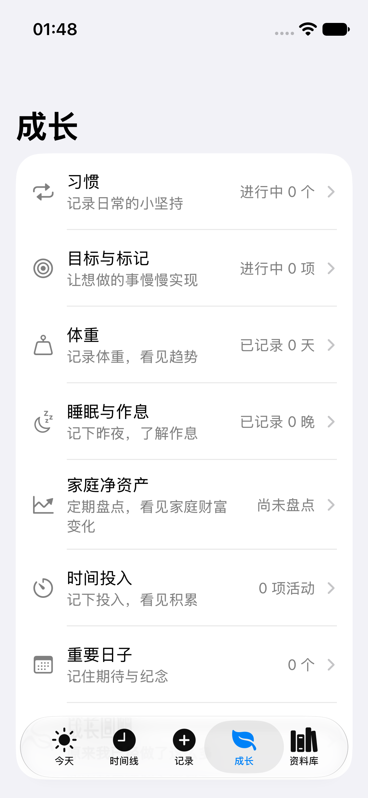
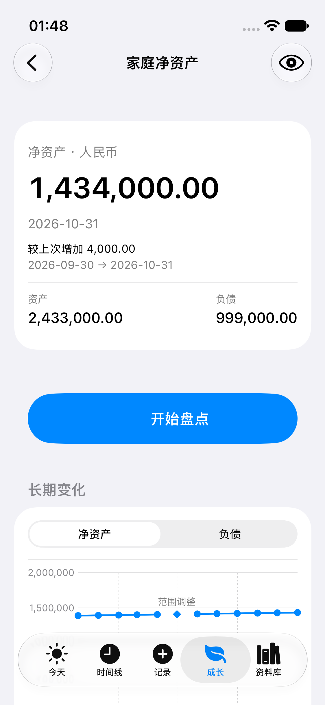
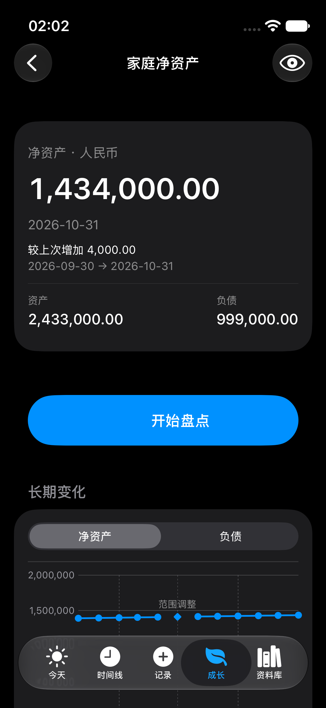
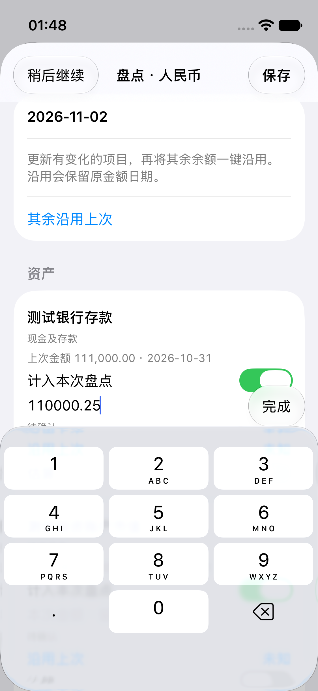
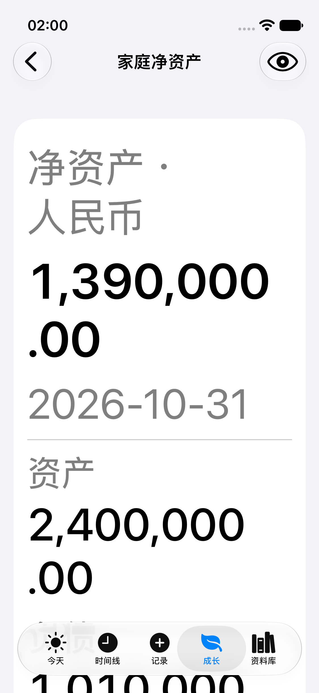
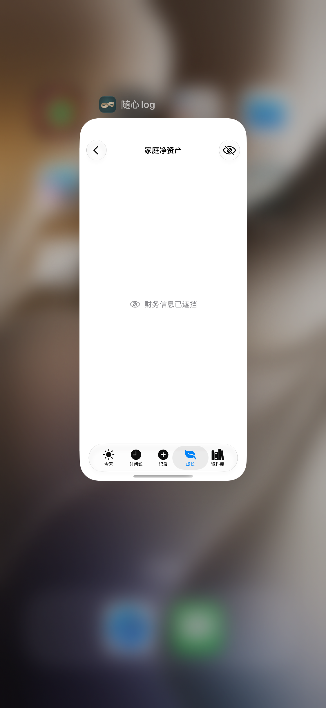
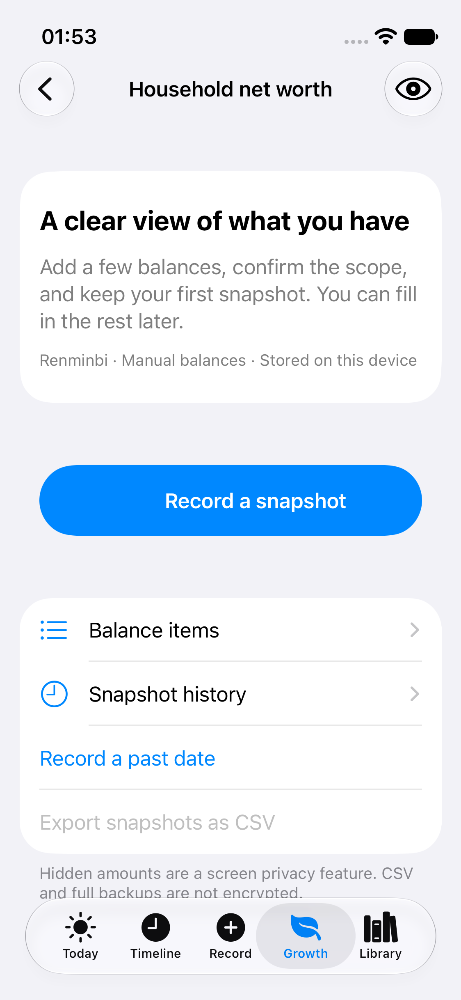
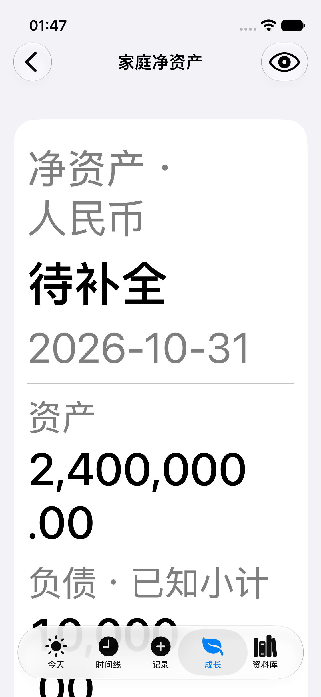
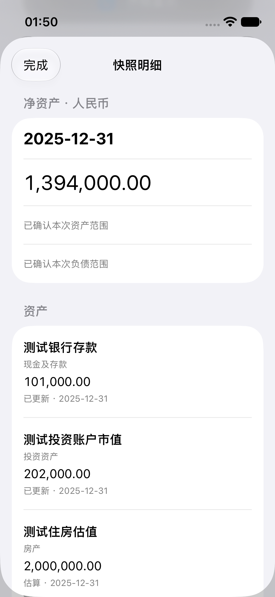
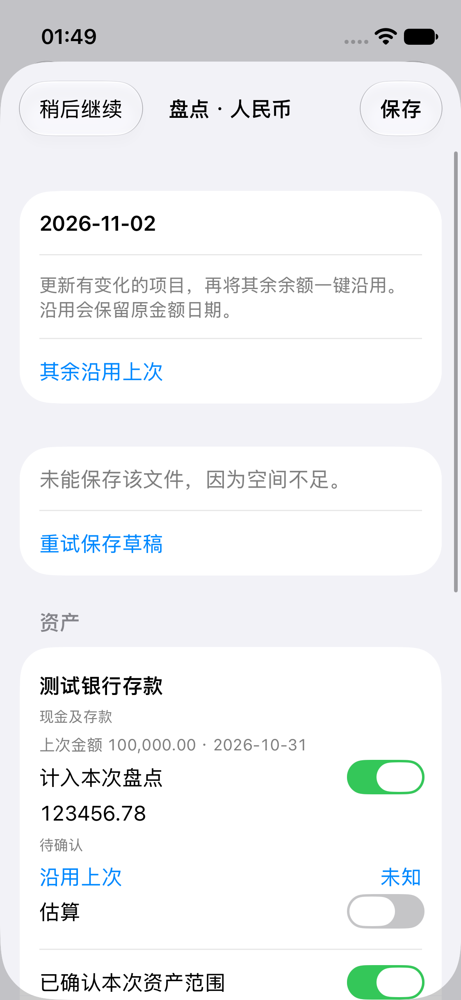

# 家庭净资产 V1.1 原始截图

全部为主 App 的真实合成数据路径，没有 Preview、HTML、拼图或图像改绘。PNG 从 xcresult 附件逐字复制，SHA256、实际源提交、测试方法、环境与采集时间见 [manifest](screenshots.json)。

各图记录各自固定源提交；后续修复影响的项目列表已更新为最终候选原图，未变更场景保留此前真实证据。原始失败与复验分别记录，不把不同提交称为同一轮测试。

## 十个主要场景

### V1-growth-neighbors

### V2-overview-light

### V3-dark-overview

### V4-repeat-keyboard

### V5-large-complete

### V6-background-system

### V7-empty-native

### V5-V8-large-partial

### V9-chart-past-point

### V10-save-failure

## 补充原图

- [V1-habit-neighbor](V1-habit-neighbor.png)
- [V1-weight-neighbor](V1-weight-neighbor.png)
- [V10-retry-success](V10-retry-success.png)
- [V2-composition](V2-composition.png)
- [V2-liability-trend](V2-liability-trend.png)
- [V2-trend-scope-break](V2-trend-scope-break.png)
- [V3-dark-items](V3-dark-items.png)
- [V3-dark-trend-composition](V3-dark-trend-composition.png)
- [V6-background-return-hidden](V6-background-return-hidden.png)
- [V6-hidden](V6-hidden.png)
- [V6-hidden-history](V6-hidden-history.png)
- [V7-single-native](V7-single-native.png)
- [V8-long-name](V8-long-name.png)
- [V8-negative](V8-negative.png)
- [V9-frozen-history](V9-frozen-history.png)
- [V9-latest-category](V9-latest-category.png)

[CR-01 旧失败原图与最终修复对照](ReviewHistory/README.md)
