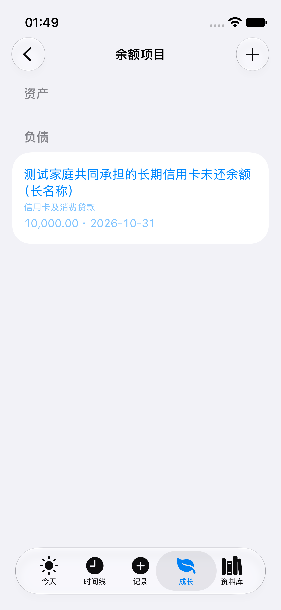

# 独立视觉审查历史失败

CR-01：默认 Button 下类别及金额日期呈浅蓝，对比度不足；此图是失败证据，不是最终通过画面。

- 源提交：`a45a910c7cb8b0070114db97850dc9d9cf1bc1f0`，c-final / testLargeCompleteAmountAndNegativeLongName。
- 原始附件：`F161925C-204B-47BC-A64B-8ECEBACE6C13.png`。
- SHA256：`54c78b0b05f21c9b8951c244942048f1c4eb062dacfcd92a0174a700fe6f182e`。
- [最终浅色图](../V8-long-name.png) / [最终深色图](../V3-dark-items.png)。

