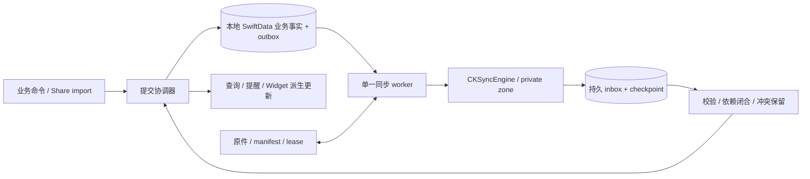

# iCloud Sync V1 架构审计与可行性结论

日期：2026-11-05。基线：[Draft PR #14](https://github.com/yoCruzer/PersonalGrowthOS/pull/14) 的最新 HEAD `96f72339a1a3082c43018e06d6115dd93df1df97`，分支 `codex/household-net-worth-v1`。不是 main，也不包含主工作区未提交改动。

本轮仅审计、隔离 PoC 与文档交付；没有改产品代码、历史 schema、工程、签名、CI 或真实用户数据。Foundation 的 Local First、隐私主动选择、数据所有权继续有效；原 V1 的“不做同步”限制不妨碍本次明确授权的研究，但本文不是正式开发授权。

## 1. 明确结论

**建议采用：本地 SwiftData 保持 `.none`，追加同步元数据与持久 outbox/inbox，由应用控制业务合并，使用 CloudKit private database + CKSyncEngine 承担传输与调度。** 不建议在现有 V16 主库上直接打开 SwiftData 自动 CloudKit 镜像，也不建议从零重写 CloudKit 的网络调度器。

原因不是“SwiftData 不可靠”，而是当前产品有大量跨对象完整性约束、设备专属状态、文件事务，以及必须保留并发用户输入的要求。自动镜像能减少传输代码，却不能替应用解决这些业务问题。单纯移除 `.unique`、加默认值、把关系改成可选，仅解决 schema 准入；不足以保证可靠同步。

**可行性为有条件成立，发布结论为 NO-GO。** 已验证本地持久化接缝和协议反例；没有验证真实 CloudKit 服务、两台设备、账号切换、后台交付、签名或生产 schema。下一步应做有明确退出标准的签名双设备技术验证，先证明端到端数据守恒，再批准产品接入。不能把本报告解读为“同步功能已完成”或“承诺绝对不会丢数据”。

“不丢数据”的工程定义：已确认保存的用户输入及原图，在上传失败、冲突、取消、进程退出、迁移和恢复后都有可定位的持久副本；并发互斥值不得静默覆盖；删除具有明确意图且旧设备不能复活；任何不可恢复情况必须能被检测并提供保留数据出口。尚未上传的唯一设备物理损坏仍需独立备份，同步不能替代备份。

## 2. 证据与本轮验证范围

入口：[验证台账与复现方式](Evidence/iCloudSyncV1/README.md)、[原生运行记录](Evidence/iCloudSyncV1/native-runs.json)、[模型清单](Evidence/iCloudSyncV1/schema-inventory.json)、[PoC 源码](PoC/iCloudSyncV1/)。

| 验证 | 实际结果 | 能证明 / 不能证明 |
| --- | --- | --- |
| 读取 V16 全部存储声明 | 39 实体、263 字段、52 个 unique、221 个无声明默认值的必填标量 | 包含设备日志和 JSON payload；字段逐项在 JSON 中，不是只查 Entry |
| 原生 macOS SwiftData 生成模型开库 | 39 实体本地开库成功 | 从基线逐字段生成，初始化器仅赋合成值；不是完整 iOS 产品构建，也不是历史迁移验证 |
| 同一模型 `.private` 开库 | 原生 `134060` 列出上述 221 字段、52 约束及 `Entry.images` | 明确证明 schema 不兼容；随后未打包 CLI 因 `bundleIdentifier != nil` 中止，exit -6，不记为成功云连接 |
| 去掉 unique 的兼容形状本地反例 | 同一业务身份的 A/B 两行都保存 | 说明 schema 放宽后必须自己去重；没有宣称两设备真实制造了重复 |
| SwiftData 事实 + outbox | 同一次 save、rollback、未 save 的进程 `_exit(73)` 后独立进程重开通过；旧 ACK 不清除新 revision | 本地磁盘接缝可行；不等于电源故障/fsync、全部业务服务或跨库原子性证明 |
| 原生 CKRecord / CKAsset | recordID 和 system fields 本地编码往返、asset 文件字节匹配；changeTag 明确为 nil | SDK 类型可用；没有伪造 server changeTag，没有发送记录 |
| 协议模拟 | 16/16 PASS，包含全部 6 种并发编辑输入顺序与重复投递 | 使用 SQLite 与因果 DAG 的独立实验，不是 CKSyncEngine 或 App 的实现/集成测试 |

本机：Apple Silicon、macOS 27.0.1、Xcode 27.2 (27B52)、Swift 6.4.2。首次宏编译被嵌套沙箱阻止，原日志 gzip 保留；获准在隔离目录编译后继续。完整 App 测试、UI、iOS 17 runtime、真机、性能、低空间、真实云端均 **NOT_RUN**。本轮不改产品，故不重复 #14 已有全量测试；旧 CI 只作为历史证据，不算同步通过。没有委派独立 reviewer，本报告是当前 agent 的审计与自检。

## 3. V16 与业务约束审计

### 3.1 存储、迁移和提交边界

- [PersistenceFoundation.swift](../PersonalGrowthOS/Persistence/PersistenceFoundation.swift)：V1→V16（含 V11Original 11.0 与 V11 11.1）均有迁移节点，V16 追加 NetWorthItem / NetWorthSnapshot；factory 明确 `cloudKitDatabase: .none`。很多历史 schema 复用当前类型，直接改这些类型可能改变多个历史 checksum，不能因“不兼容旧 App”而放弃旧库升级。
- [AppContainer.swift](../PersonalGrowthOS/App/AppContainer.swift)：主库仍在 Application Support/PersonalGrowthOS/Store/PersonalGrowthOS.sqlite，原件不在 App Group 主库中。当前版本先只读完整性检查，非当前版本先做 SQLite/WAL 保留副本；有不一致则保留原数据并停止正常写入，不能清库重建。启动还进行媒体协调、Habit bootstrap、关系验证和投资操作已消费内容清理。
- [StorePublication](../PersonalGrowthOS/ExternalCapture/ExternalCaptureImport.swift)：按标准化根路径注册 `NSLock`；主线程 try-lock，后台 worker 等待，锁内不 await。它是**进程内**锁，不是分布式锁，也不会拦截 SwiftData 的后台 CloudKit 镜像。同步应作为唯一主 App writer 的一个入口，使用同一提交协调器；Share Extension 继续只写 inbox、Widget 继续只读投影。
- 存在长期 mainContext、临时 ModelContext、ModelActor reader、服务级 `save/rollback` 和各模块通知。同步不得仅订阅 UI 通知生成 outbox（save 后、通知前退出会丢待上传事实），也不得用一个后台 context 的 rollback 丢弃别的编辑草稿。所有业务 mutation 必须同事务写事实和 outbox，远端应用后再通知缓存/查询/提醒刷新。
- `TechnicalTimestamp.updated` 的 `max(now, createdAt, previous)` 仅防本机回拨；两个离线设备可以有相同 revision、不同内容，不能用它或整数 revision 当分布式先后顺序。

### 3.2 全部 39 实体的同步边界建议

下面是架构建议，不改变当前行为。S=同步业务事实，D=仅设备状态，M=必须拆分或按语义处理。所有对象保留原 UUID；自然键用于识别业务冲突，不允许按内容相同就合并两条真实记录。

| 实体（数量） | 建议 | 必须保留的约束 / 冲突处理 |
| --- | --- | --- |
| Entry、ImageMetadata（2） | S | 正文或图片至少一项、最多 9 图、顺序和三种时间；镜像 metadata 不会传文件；Entry 与完整图片清单为可验证快照 |
| Tag、ObjectLink（2） | S | normalizedName 与 typed endpoints/deduplicationKey；同名 tag 需 alias 映射、重指关系并保留显示名冲突；不能把重复 link 当两次关系 |
| Habit、HabitLog（2） | S | 简单打卡不生成 Entry；once/day 与 multiple/day 区分，同日两个多次事实不能盲目合并；once/day 冲突不双计 |
| HabitConfiguration、HabitLogDayMetadata、HabitPlanRevision、HabitLifecycleEvent（4） | S | 配置/日元数据是一对一；有效 LocalDay、原时区、plan 覆盖与生命周期保留；同日 revision 冲突不可静默重排事实 |
| Goal、GoalLifecycleEvent（2） | S | Flag 仍是 Goal kind；状态和对应事件不能成为互相矛盾的半次事务 |
| WeightRecord、BodyReferenceSettings（2） | S | 体重数值和原日期精度；设置固定 singleton ID；同日不同体重不自行防重，设置冲突保留待选择 |
| WeeklyReview（1） | S | weekIdentifier 唯一；两设备同周不同文字保留候选，不用 last-write-wins 覆盖；跨时区不改原 period |
| EntryPin、EntryFollowUp（2） | S | pin 的 entryID 唯一与最多三条展示规则；补充独立身份，均不得改原 Entry 技术时间；并发 pin 保留事实、确定性展示前三项 |
| EntryExternalSource、CaptureImportReceipt（2） | S | 来源按 entryID；receipt 在 Entry 删除后仍保留，阻止待清理分享复活；不要用 URL 当 Entry 身份 |
| TodoTask、TodoTaskEvent、TodoList、TodoSeries、TodoTaskSource（5） | S | occurrenceKey / series+index、最多一个 Open 后继、事件 sequence、撤销/停止/未来模板规则、来源删除只解链；需要系列级合并单元，不能对多行逐条 LWW |
| TodoSeriesPreferences、TodoReminderIntent（2） | S/M | 星期掩码与提醒意图可同步；intent generation 是意图版本，不是另一设备已授权/已排期的证据；另存因果版本 |
| TodoReminderDeviceRecord（1） | D | native request UUID、accepted/cancellationPending 等只属于本机；当前明确不进备份。不能同步或用另一设备 accepted 代替本机确认 |
| ImportantDay、ImportantDayEntryLink、ImportantDayTodoLink、ImportantDayCover（4） | S/M | 公历/农历/未知年/期次、typed pairKey、独立封面所有权；preferencesData 混有提醒、desktopVisible 等，拆设备公开授权与可同步内容偏好 |
| SleepRecord、SleepGoalRule（2） | S/M | wakeDay/effectiveDay 唯一，未知不是零；保存原时区、区间、填写证据、observedAt 和 hasTakenEffect 语义；远端观察不能伪装成此设备已观察，冲突先隔离 |
| InvestmentParticipant、InvestmentActivity、InvestmentSession、InvestmentOperation（4） | S/M | 默认“我”不能两机各造新身份；正式 session 为时长唯一事实；operation 的 consumed 身份不能复活。计时 anchorUptime/processID 仅设备有效，持久草稿/未完成输入需可恢复投影，不能跨机继续计时 |
| NetWorthItem、NetWorthSnapshot（2） | S/M | JSON 内 UUID/版本/revision 与外层一致；正式快照按 day 唯一、单草稿、整数分、未知、沿用原金额日、冻结历史、归档须最后纳入余额为零；同日两快照保留冲突，不相加 |

实体字段与源码位置见 [schema-inventory.json](Evidence/iCloudSyncV1/schema-inventory.json)。上述业务约束还来自 TODO_V1_SCOPE、IMPORTANT_DAYS_V1_DESIGN_ZH、SLEEP_ROUTINE_V1_DESIGN_ZH、TIME_INVESTMENT_V1_DESIGN_ZH、HOUSEHOLD_NET_WORTH_V1_SPEC_ZH；旧家庭资产 1.0 规格已废止，不混入 Entry 关联或 Face ID。

### 3.3 JSON payload 与跨对象约束

[NetWorthFoundation.swift](../PersonalGrowthOS/NetWorth/NetWorthFoundation.swift) 的两个实体仅有 id/payload。模型“字段少”不代表同步简单：payload 内是快照与最多 10,000 行的冻结明细，单行 note 可 1,000 字。合法内容可能超过 CloudKit 普通 record 的 1 MB 上限；必须测量编码后的字节，采用版本化 CKAsset payload 或有 manifest 的分片，不能盲塞 Data 字段。快照整体语义需原子发布，缺一片不进入统计。Apple 的现行技术说明仍列出普通记录 1 MB（不含 asset）；不能把历史 Web Services 每请求数量当作未来 SDK 的唯一边界。[TN3164](https://developer.apple.com/documentation/technotes/tn3164-debugging-the-synchronization-of-nspersistentcloudkitcontainer)

Sleep.valueData、Investment.valueData/payload、ImportantDay.ruleData/preferencesData、Todo.beforeValue/afterValue 同样需要 wire version 和明确 codec。跨字段编辑必须保持领域不变量；不应对 JSON 字节做“最后修改胜出”，也不能把 before/after 事件片段直接拼成完整合法链。未知版本应原样保留并标记待升级，不触发默认枚举回退后上传损坏内容。

## 4. 图片、分享与派生缓存

[MediaStore.swift](../PersonalGrowthOS/Media/MediaStore.swift) 将原图存于 `Media/Originals/<prefix>/<UUID>.<ext>`，保存 byteCount、SHA-256、类型、尺寸；单原件限 25 MiB。缩略图可重建。重要日子封面拥有独立原件，删除来源 Entry 不应删除封面。

现有永久删除是“移到 Trash → 数据库删除/保存 → purge”，失败回滚文件；启动可恢复 Trash，未引用 Originals 移至 Recovery/Orphaned，Staging 会清理。直接让 metadata 跨设备出现会把“尚未下载”误判成“丢原图”，让“文件先到、关系后到”误判成孤儿。**同步 staging 必须独立于现有通用 Staging，GC 必须认识待下载、待提交、冲突引用和上传 lease。** 不能在首次打开或一次 fetch 后认为全量云记录已到齐。

建议：

1. `AssetManifest(assetID, sha256, byteCount, mediaType, originalFilename, owner, revision)` 与原件分离；云端用 CKAsset，保留独立 UUID 所有权。相同 hash 可做内部缓存优化，但不能改变业务身份或因删除一个引用而删另一个。
2. 下载至专属临时文件，校验大小/hash/类型后原子安装；再发布引用。若先展示 metadata，要显式显示“原图待下载”，不得把图片唯一的 Entry 判为空而删掉。
3. 上传原图在所有待上传版本和未决冲突解除前持有 lease；后台重试/取消不删除唯一副本。CKAsset 只保存内容，文件名等须显式存入 metadata。[CKAsset init](https://developer.apple.com/documentation/cloudkit/ckasset/init(fileurl:))
4. 删除先产生逻辑 tombstone，独立记录原图回收资格；离线旧设备、冲突、待确认删除未解决前不硬删唯一副本。V1 先不自动清理安全性无法证明的 tombstone；后续引入设备退役/全量重建协议后再讨论保留期限，不能随意定 30 天。
5. “完整备份”必须包含该快照的全部原件；缺图时可以下载补齐或明确失败/保留上次完整备份，不能输出漏图包并标完整成功。

Share Extension 继续使用原子 inbox；主 App import receipt、Entry、媒体清单和 outbox 同一逻辑提交，重试包不重复创建。Widget 继续只读 App Group 投影；收到远端提交后先处理公开授权，再重建/撤销缓存，不把其他设备的桌面展示选择默认为本机公开许可。

## 5. 提醒与跨设备副作用

[TodoReminders.swift](../PersonalGrowthOS/Todo/TodoReminders.swift)、[TodoAlarmReminders.swift](../PersonalGrowthOS/Todo/TodoAlarmReminders.swift) 已有共享排队预算（代码保守值 60）、generation、原生接受后日志确认、取消确认、冷启动重试和跨模块分配。每日记录/周回顾、睡眠偏好主要在 UserDefaults；通知权限、AlarmKit 权限、实际 OS 请求均在设备上。当前三套 entitlements 仅 App Group，尚无 iCloud/CloudKit entitlement。

同步只传用户意图，不传 permission、accepted、native request ID、实际 ringing 状态或全局“已排好”。收到变更不弹权限；用户在本机主动开启后才能调度。远端完成/取消/删除需进入本机同一协调器，必须等待旧请求取消确认，避免过期请求迟到重装；取消失败如实显示，不因云同步成功显示提醒成功。

单次提醒保持绝对时刻；重复提醒保持原定民用日、分钟、日期偏移及 DST 策略。本机调度解析用设备时区，不能把解析结果回写成全局意图引发两台设备往返修改。多设备是否都提醒是产品策略：建议本机独立选择，默认不新增远端提醒授权；不宣称离线下能保证“全世界只有一台响”。

## 6. 备份、恢复与用户数据保护

[ImportExportService.swift](../PersonalGrowthOS/ImportExport/ImportExportService.swift) 当前 export 在 StorePublication 锁内生成一致 TransferSnapshot、原图 hash 和 ZIP；preview 解包验证；import 先在隔离库 materialize/save/reopen 校验，再发布媒体，晚检查空库，再保存；失败只清本次拥有的媒体，取消检查保留。v12 可读合法 v1–v12，包含 capture receipts 和投资未完成操作，不包含提醒设备日志。**备份格式不等于同步 wire protocol**：它是全库快照，没有云账户绑定、同步 cursor、分布式 tombstone 或冲突谱系。

必须保持的保护路径：

- 首次升级：保持包身份/主库路径；停 writer，做可验证 SQLite+WAL 一致副本与媒体清单/原件保留；检查可用空间；只在副本验证追加 schema、重开与全量事实对照。不要只复制 `.sqlite` 忽略 WAL，也不要修改 V1–V16 的共享类型作为“迁移捷径”。已有旧 App 不需继续同步，但已有旧库和合法备份必须可迁移。
- 首次开启：默认关闭，明确告知上传范围（含私人记录、健康/财务内容），用户主动选择后绑定账户和 datasetID。先持久化基线枚举/检查点；上传可重试且不中断本地新写入。两台已有数据设备不能各自“本地覆盖云端”；使用 UUID、迁移映射和业务键识别重叠，保留不同内容。旧备份无 datasetID 时不能猜测它属于云数据集。
- 恢复：暂停同步发送与业务投影应用；提高 operation epoch，取消并等待在途任务，晚回调被 epoch fence 拒绝。远端数据可持久暂存，但不能越过恢复空库门。验证/发布/重开后再决定同步连接。备份中不能恢复旧云 token、deviceID、权限、ACK 或 CKRecord system fields。
- 默认将旧备份恢复到**隔离的本地新数据集**，重建 sync metadata；随后显式选择合并同一来源数据集或作为新数据集接入。绝不能把旧快照内容缺失解释成云端删除，也不能把恢复当无条件 upsert 复活已有 tombstone。需要明确的身份映射和冲突预览，才可接回既有云空间。
- 不提供隐式“恢复并覆盖全云”。若未来要支持，必须另行设计账户/dataset generation 切换与撤销，旧设备重连先拒绝旧 generation，不能靠一批 delete 顺序实现。
- 回滚 App/同步开关不等于降级数据 schema：禁用同步保留本地全部数据、队列和未决冲突；损坏时保留原始库与 raw recovery 出口。未上传数据不得因登出清空。

## 7. 两条路线比较

Apple 明确说明 SwiftData 的 CloudKit 模式不支持 unique、非可选关系，关系变更不会保证原子到达，且必须配置容器和 Remote notifications。生产 CloudKit schema 的演进也比本地轻量迁移严格。[SwiftData 同步说明](https://developer.apple.com/documentation/swiftdata/syncing-model-data-across-a-persons-devices) · [Apple schema 演进说明](https://developer.apple.com/videos/play/wwdc2022/10120/)

| 维度 | SwiftData + 自动 CloudKit | 本地 SwiftData + 自有协议 + CKSyncEngine |
| --- | --- | --- |
| 初始成本 | 简单模型低；本仓库需大幅 schema/边界重构 | 较高，需可审计协议、outbox/inbox、codec、冲突与状态 UI |
| V16 适配 | 52 unique、221 必填、非可选关系；必须改新 schema 与迁移/业务校验 | 现有约束留在本地，追加元数据；不绕过本地领域验证 |
| 文件 | 自定义目录不会自动随 metadata 同步；需 binary external storage 或另一资产层 | CKAsset + manifest/lease，可与现有 MediaStore 接缝统一 |
| 多行事务与空库恢复 | 镜像后台写入不进入 StorePublication；需独立同步容器/投影才能可靠隔离 | 应用控制 durable inbox、依赖完成后原子投影及恢复 fence |
| 身份/业务键 | 需去重、alias、冲突策略；不能靠云唯一约束 | 明确 recordID、逻辑 UUID、业务键冲突与版本 lineage |
| 冲突“不丢输入” | 自动框架行为不足以直接满足保留并发候选，需要额外设计 | 应用保存冲突候选和明确解决；可测试每个拒绝/保留分支 |
| 账户/设备状态 | 仍需分库或排除设备专属表，控制本地保留 | account+dataset+epoch 隔离；本机状态不进 wire |
| 传输与运维 | 框架托管较多，控制和诊断粒度受限 | CKSyncEngine 管调度/部分重试，应用负责持久化状态和业务错误 |
| 当前结论 | **否决直接启用；不否决重新设计的自动镜像方案** | **推荐有条件推进**；测试和维护成本必须预算 |

备选：另建完全兼容的 SwiftData sync-only envelope 库，再投影现有主库。它可以避免改 V16，但仍需双库 crash recovery、冲突、媒体和同步边界，削弱了自动方案的简单性。本轮不推荐将这层隐藏复杂度当作低成本捷径。

## 8. 推荐协议与改造清单

### 8.1 身份、版本与原子性

- private database 的自定义 zone 按 dataset 隔离；建议先单数据集，schema 独立版本。recordName 使用 dataset/type/稳定对象 UUID，不用持久化框架内部 ID、URL、数组下标或时钟。已存在对象保留 UUID；新产生的单例/期次使用稳定业务身份。自然键冲突和 UUID 冲突不是同一种情况。
- 初始推荐 **稳定对象记录 + 有身份的 mutation/conflict 候选**：每次 mutation 有 UUID、device installation ID、父版本集合（或等价因果时钟）、wire version、内容 hash、tombstone；CAS 更新对象 head。冲突时先持久保存双方完整 payload 与父版本，再生成 merge mutation。V1 不建设对用户展示的全量版本历史；保留未解决冲突和恢复所需前驱，安全压缩以后单独证明。
- PoC 的不可变 mutation DAG 是验证上述因果语义的最小模型，**没有实现真实 CAS/head record、GC 或 CloudKit changeTag 交互**。正式实现可以使用同等因果信息的其他编码；不能缩减为 wall-clock LWW。
- 业务事实、outbox、版本元数据在**同一个本地 store、一次显式事务**提交；迁移追加模型，不将 outbox 放另一 sqlite 再先后 save。网络工作只能发生在事务外。上传快照绑定 mutationID，返回 ACK 只能确认这一版本，不得删同对象较新的 outbox。
- inbound 先 durable inbox，和相应 fetch checkpoint 同事务；依赖不足留暂存，不能直接插半张业务图。已接收 cursor 表示“字节已持久”，不表示“业务已应用/所有图片已可用”。远端事件→应用提交→通知消费者，不让模型的自动 observer 再生成上传 echo。
- CKSyncEngine 的 state serialization 需应用保存；其暂态重试不能代替 outbox。遇到 `serverRecordChanged` 必须自己合并。state 写入与入站数据提交必须有明确先后/原子检查点；宁可重复拉取，也不能先推进 token 再丢变更。[CKSyncEngine](https://developer.apple.com/documentation/cloudkit/cksyncengine-5sie5) · [stateUpdate](https://developer.apple.com/documentation/cloudkit/cksyncenginestateupdateevent)
- 同 zone 的 CloudKit atomic batch 可以辅助，但跨批次、文件、本地事务、接收方可见性不能依赖全局原子。业务复合对象需要 manifest/revision group，接收方验证齐全再发布。[isAtomic](https://developer.apple.com/documentation/cloudkit/ckmodifyrecordsoperation/isatomic)

### 8.2 冲突、删除与修复

| 场景 | 推荐可观察结果 |
| --- | --- |
| 同对象离线改不同字段 | 只有已定义的独立字段可三方合并；结果过领域校验；保留输入版本直到确认持久 |
| 同字段文字、同日睡眠/周回顾/净资产 | 不静默覆盖；保留两个候选，业务投影保持上次合法结果，展示待处理冲突；未知不转零 |
| 删除 vs 旧编辑 | tombstone 不被旧快照覆盖；并发编辑作为可恢复冲突副本，正常视图不自动复活；显式恢复产生新意图 |
| 同一真实记录重复到达 | mutationID 幂等，UUID 身份相同不新建；同 ID 不同字节拒绝并留诊断 |
| 内容相同但不同 Entry / 多次 HabitLog | 保留两次事实，不做内容 hash 去重；业务唯一类别另外识别冲突 |
| Todo 同期并发完成 / 撤销 / 停止 | 系列级重算有效投影、保留事件分支；只一条合法 Open，不能重复生成后继或擅自恢复 canceled |
| 子记录先到、父记录已删 | 暂存并查 tombstone/依赖；不当缺父垃圾删掉，也不制造空父占位污染统计 |
| token 过期、zone 被删 | 先保留本地数据/outbox；重新扫描/重新绑定或显式修复；不把空服务器解释成删除全部本地 |
| 部分失败、配额满、限流、网络断开 | 按 record 处理成功/失败，保留未确认本地；退避并支持手动重试，核心 CRUD 无网络可用 |
| 账号退出/切换、禁用同步 | cancel + epoch fence 所有 send/receive/asset/ACK 回调；冻结原账户队列和库，不自动上传到新账户 |

账户绑定至少区分 `container/environment/account/datasetID/local generation`；同 Apple ID 的两台设备共享 dataset，installationID 不能随备份复制。新账号新空间，用户主动选择是否复制本地资料；旧账号未上传资料仍可查看/导出。这里不能照搬示例代码“登出就清本地缓存”的做法，因为本产品本地数据不是可丢弃缓存。

### 8.3 需要修改的生产接缝（未来开发，不在本 PR）

| 改造 | 主要落点 | 完成判据 |
| --- | --- | --- |
| 冻结旧 schema，追加同步实体/迁移 | PersistenceFoundation、AppContainer | 精确旧库副本升级、重开、失败保留、字段/图像逐项对照 |
| 所有 mutation 同事务 outbox | Entry/Habit/Goal/Organization/Review/Weight/Todo/Sleep/Investment/NetWorth 服务、ExternalCaptureImporter、恢复 | 覆盖 create/update/delete/bootstrap/restore，故障前后无“已保存但永不上云” |
| 编码与聚合边界 | 各 Transfer 值类型旁的新 wire codec | DTO 白名单，大小/未知版本/自然键/时间精度/JSON校验；不直接复用全库 ZIP |
| 设备状态拆分 | TodoReminderDeviceRecord、ImportantDay preferences、Sleep 观察与提醒、投资 timer、Widget | wire 中无设备请求/权限/连续时钟；跨设备收到数据不会自行授权或继续计时 |
| cloud worker 与账户状态 | 新同步服务 | durable state、每条 ACK、重试、冲突、zone/token/account reset、取消 fencing |
| 依赖暂存与合法投影 | inbox + 领域校验适配 | 不完整远端图不触发 App 启动失败；不能关闭原完整性检查来让同步“通过” |
| 图片生命周期 | MediaStore、StartupMediaReconciler、ImportExport | staged/downloaded/ready/failed/leased/GC 清晰，所有 hash 和唯一原件守恒 |
| 恢复/首启/关闭同步 | ImportExportService、Settings、AppContainer | 原子恢复隔离、本地保留、显式 dataset 绑定、诚实进度与错误 |
| 读者刷新 | AppShell、reader/cache、Search、QuietWins、WidgetPublisher、提醒协调器 | 同一提交版本的派生结果；不自动增加 Entry 或重复统计 |
| 能力与环境 | App entitlement、Background Modes、Development CloudKit schema | 测试和生产隔离；不改变 Bundle ID / App Group；签名发布另行门禁 |

## 9. 风险排序与产品决策

P0 表示正式同步上线阻断，不表示当前 local-only App 已发生数据损坏。

| 等级 | 风险 | 必须采取的措施 |
| --- | --- | --- |
| P0 | 自动导入半张图使完整性检查阻断启动；后台写绕过恢复锁 | inbox/依赖闭合/合法投影，同步加入提交协调器 |
| P0 | 并发文字/金额被 LWW 擦掉、旧 ACK 吃掉新写入 | 因果版本、冲突副本、精确版本 ACK、故障注入 |
| P0 | 图片 metadata 已同步但原件丢失、提前 GC、漏图“完整备份” | asset manifest/hash/lease、原件保留、备份闭合性门禁 |
| P0 | 账号 B 接收到账号 A 私人数据；旧备份复活删除 | account/dataset/generation fence，恢复隔离，tombstone |
| P0 | 改旧 schema 或清库导致现有用户数据损坏 | 追加迁移、真实格式合成旧库重放、原始副本、失败出口 |
| P1 | 默认“我”、自然日、周期后继、单草稿并发破坏统计 | 身份映射和领域冲突 UI；禁止双计/自动求和 |
| P1 | 导入提醒日志/桌面公开偏好导致重复提醒或隐私外露 | 设备局部状态，用户显式授权，远端提交后重算 |
| P1 | 大 payload、低空间、配额/限流、后台不执行 | 大小分层、有界队列与退避；前台 catch-up，不承诺实时 |
| P1 | 自建协议维护成本被低估 | 按下节门禁分阶段；未通过端到端阶段不得接全模块 |

实施前需批准的三项语义：

1. **冲突呈现**：建议保留上次合法业务投影并提供冲突待办/导出；用户可以查看并选择/合并，不静默取最新。对无旧投影的重复自然键先保留候选，不计两份统计。
2. **未完成操作**：建议同步可恢复的用户草稿/检查点，但标明来源设备，在另一设备只读候选；继续计时必须显式接管并清除本机无效 anchor。V1 可先保持正在运行的计时本机独占，但必须明确标为不同步实时运行状态，并仍完整备份/保留输入。不能在无限离线条件下同时保证任意设备可启动和全局最多一个 timer；必须在产品层选择，不能靠锁伪装保证。
3. **多设备单草稿/公开与提醒**：净资产两机草稿均保留为候选，不能直接进当前“最多一个草稿”的表；桌面公开、通知/闹钟执行本机独立选择。正式快照仍按日唯一，不能为迁就同步偷偷放宽业务校验。

这些选择不阻塞本次审计交付，但阻塞相应正式实现。推荐方案的必要复杂度来自这些已存在的业务约束。

## 10. 开发阶段与验收门禁

所有阶段只用合成数据或用户**另行明确授权的副本**。当前报告未授权任何真实用户库操作。

| 阶段 | 范围 / 出口 | 验证尺度 |
| --- | --- | --- |
| G0 本轮审计 | 固定 #14 HEAD、39 实体清单、两路线比较、隔离 PoC、报告 Draft PR | 已完成的本地证据见台账；没有声称云端通过 |
| G1 签名技术验证 | 独立 App ID / Development container / 两台隔离测试设备与测试账号；Entry+图片+因果冲突+outbox/inbox+account fence 纵向路径 | 真正双设备、真实 changeTag/serverRecordChanged、断网与退出、CKSyncEngine state 重建。若无法证明不丢输入，停止正式接入并重评方案 |
| G2 本地升级与写入接缝 | 新 schema、所有业务 writer 清点、事务 outbox、bootstrapping/数据集绑定、迁移保护 | 精确 V16 与实际支持的早期 schema 合成旧库、v1–v12 合法包；事务前/后、崩溃/取消/低空间配对验证；不改旧输入 |
| G3 领域与媒体集成 | 39 实体逐项决策落实、冲突队列、图片、备份恢复、提醒/Widget/Share 保护 | 除改模块外验证邻接生产消费者；真实 ZIP/媒体重开、乱序依赖、删除重连、缓存与统计一套事实 |
| G4 系统验收 | 故障恢复矩阵、可观测状态、隐私日志、容量与性能、独立审查 | 主机完整相关 Unit、关键 E2E/回归一次集中跑；稳定 SHA 远端 CI 独立验证，必要缺陷修复后只补有因果关联检查 |
| G5 Owner 决策 | 真实设备体验与保留数据升级演练获批后才考虑发布 | 审计不授权 merge/tag/Archive/TestFlight；既有 #14 真机门禁保持 |

最低验收矩阵（未来同步通过的必要条件）：

- **A01 离线保存**：未登录/飞行模式连续创建、编辑、删除、搜索、图片查看；每次成功 save 后杀进程重开，内容/ID/hash/业务日不变，outbox 可追踪；保存失败输入仍在。
- **A02 初始合流**：两台空库、两台各有内容、同源备份的两副本、相同内容但独立 Entry；只按身份和业务规则识别，0 静默丢失、0 无解释重复。
- **A03 并发**：同字段/不同字段、时间回拨、同 revision、相同时间戳、所有关键投递顺序与重复重试；两端最终合法投影及冲突集合一致。
- **A04 删除**：删/改、删父/加子、设备长期离线、旧备份、token 过期；不会静默复活，冲突输入有可恢复副本，原图回收有证据。
- **A05 图片**：0/1/9 图、25 MiB 上限内外、封面独立副本、损坏/截断/缺失/先到后到；metadata 和 manifest/hash 一致，漏图不得称完整备份。
- **A06 本地故障**：保存前后、outbox ACK 前后、inbox/token 前后、下载校验/rename 前后分别退出；以独立 oracle 比较 ID/字节/候选，不用被测合并器生成期望。
- **A07 云端故障**：真实 serverRecordChanged、partial failure、quotaExceeded、限流、zoneNotFound/userDeletedZone、token 失效、未授权/临时不可用；不忙等、不丢待发送，恢复后收敛。
- **A08 账户隔离**：A→退出→B→A，发送、下载、asset 安装、ACK 每个 await 点切换/取消；旧回调不能影响新空间，A 本地未上传仍可导出。
- **A09 恢复竞争**：预览后本地新写、远端到达、图片安装后失败、保存前取消与保存后返回取消；每次要么完整旧状态，要么完整已提交状态，有准确反馈，不能混装。
- **A10 业务不变量**：Habit once/multiple 与历史计划、Todo 单 Open/事件链/未来模板、Sleep 唯一 wakeDay/未知区间、NetWorth 单 day/整数分/冻结/归档零余额、Investment 唯一时长/consumed 操作；冲突不把 App 正常启动锁死。
- **A11 副作用**：提醒权限不跨机授予、不重排已停止闹钟；迟到完成先清理旧请求；Share receipt 不复活删除；Widget 撤销公开后不会继续发布旧缓存。
- **A12 升级与退出**：旧库+WAL+媒体重放、迁移失败、关闭同步、云空间删除、回滚策略；原字节保留、未上传内容有出口，旧 App 可不支持新格式但不能毁掉旧数据。
- **A13 容量与后台**：建议合成 10k Entry、1k 原图和 10k 行净资产边界，记录磁盘增量/峰值内存/主线程停顿/首次与增量耗时；数值预算在 G1 按目标真机定基线，不能凭本轮 16 个微测试宣称性能达标。至少 iOS 17 最低版本和当前系统；强退、低电量、不触发 push、长期后台后前台最终可恢复，不承诺后台 SLA。
- **A14 证据与隐私**：每轮记录 SHA/dirty、OS/Xcode/设备、命令/退出码、测试计数及失败；日志不包含正文/金额/图像/账户标识，诊断导出需用户主动；固定候选进行独立代码与数据完整性审查。

下一步建议：批准 G1 的隔离测试容器/测试设备配置与上述三项产品语义，先完成一个两设备“文字+图片+冲突+登出保留+空库恢复隔离”的闭环。G1 通过后再编写正式实施 Goal；本次在报告和 Draft PR 交付处停止。
